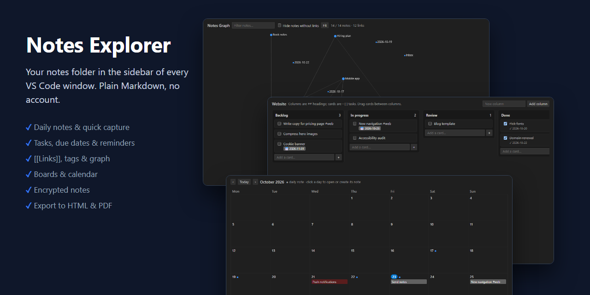
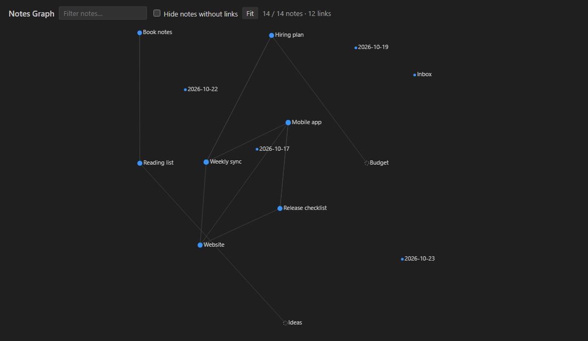
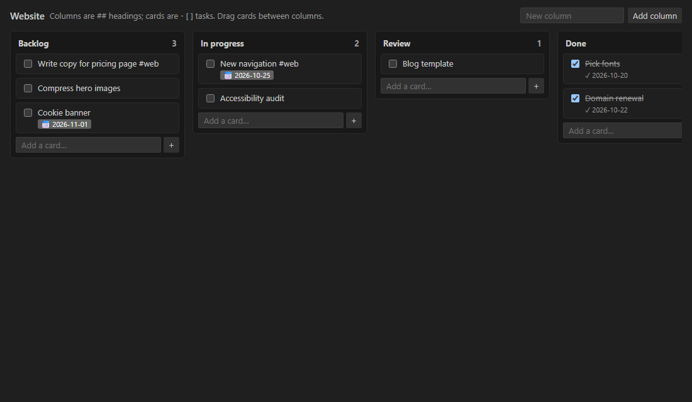
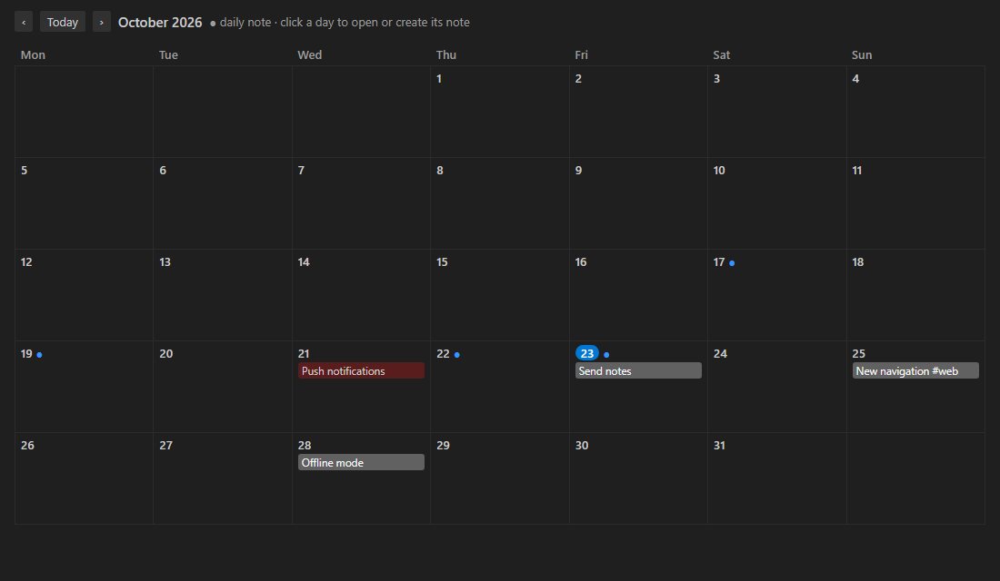

# Notes Explorer

[](https://marketplace.visualstudio.com/items?itemName=AravindMerugu.notes-explorer)
[](https://open-vsx.org/extension/AravindMerugu/notes-explorer)

Your notes folder in the VS Code sidebar, in every window, without opening the folder. Plain Markdown files on disk: no database, no account, no lock-in.



Works in VS Code and in editors that install from Open VSX, such as VSCodium, Cursor and Windsurf.

## Getting started

1. Install **Notes Explorer** from the Extensions view (`Ctrl+Shift+X`).
2. Click the **Notes** icon in the Activity Bar, then **Set Notes Location** and pick any folder (an existing one works).
3. Press `Ctrl+Alt+D` for today's note, or `Ctrl+Alt+N` to open any note by name. On macOS use `Cmd+Alt`.

Everything is stored as ordinary `.md` files, so you can keep the folder in OneDrive, Dropbox or a Git repository and edit it with any other tool too.

## Features

| Feature | How |
| --- | --- |
| Browse & edit notes | Notes icon in the Activity Bar → click a note |
| Quick open by name | `Ctrl+Alt+N` (pinned and recent notes are listed first) |
| Search text in all notes | `Ctrl+Alt+F`. Toggle match case, whole word and regex with the buttons in the search box. Right-click a folder → *Search in Notes* to search only that folder; an active tag filter also limits the search |
| Daily note | `Ctrl+Alt+D` or the calendar button opens `Daily/2026-10-23.md`; *Open Yesterday's Note* in the `…` menu |
| Quick capture | `Ctrl+Alt+C` appends a line to `Inbox.md` without leaving your current file |
| Templates | *Manage Templates* in the `…` menu. New Note asks which template to use |
| Pinned & recent | Right-click a note → *Pin Note*. The **Quick Access** view shows pinned and recently opened notes |
| Tasks across all notes | **Tasks** view, click ✓ to mark done (adds `✓ 2026-10-23`); status bar shows the open count (⚠ overdue) |
| Task filters | Filter button in the Tasks view: overdue, due today, next 7 days, no due date, completed this week, or by `#tag`. Sort button switches between grouped-by-note and by due date |
| Archive finished tasks | Right-click a note → *Move Completed Tasks to Archive Section* moves `[x]` items under `## Completed / ### date` |
| Reminders | `- [ ] Send report @due(2026-11-01)` |
| Link notes | `[[Meeting Notes]]`. Autocompletes after `[[`; hover a link to preview the note; the **Related Notes** view shows backlinks |
| Link checks | Links to notes that don't exist are underlined, with a quick fix (`Ctrl+.`) to create the note |
| Rename keeps links | Renaming a note offers to update every `[[link]]` to it (`notesExplorer.links.updateOnRename`) |
| Rename a tag | `…` → *Rename Tag…* changes `#old` to `#new` in every note |
| Graph | `…` → *Show Graph*: notes as dots, links as lines. Click to open, drag to arrange, scroll to zoom, *Fit* to recentre |
| Board | Right-click a note → *Show as Board*: `## headings` are columns and `- [ ]` tasks are cards. Drag cards (or `Alt+←/→`); dropping into *Done* ticks them |
| Calendar | `…` → *Show Calendar*: daily notes (●) and due tasks by month. Click a day to open or create its note |
| Export | Right-click a note or folder → *Export to HTML…* / *Export to PDF…* (PDF uses Edge or Chrome) |
| Notes for code files | Right-click a file in the Explorer or an editor tab → *Link Note to This File*. When that file is open, **Related Notes** lists its notes |
| Tags | `#ideas` anywhere; the filter button shows only matching notes |
| Project notes | `Ctrl+Alt+P` opens the notes folder for the open project. Right-click any folder → *Use Folder for Current Project* to choose it |
| Paste images | Paste or drop an image into a note; it's saved to `assets/` next to the note and linked |
| Hide sensitive values | Off by default. Add patterns to `notesExplorer.mask.patterns`; matching values show as `••••••`, and hovering offers *Copy* |
| Sort & dates | `…` → *Sort By…* (name, modified, created) and *Show/Hide Modified Time* |
| Recurring tasks | `- [ ] Water plants @every(week) @due(2026-10-23)`: ticking it adds the next one. Rules: `day`, `week`, `month`, `year`, `weekday`, `3 days`, `2 weeks`, `monday`, `mon,thu` |
| Encrypted notes | Right-click a note → *Encrypt with Password…*. It opens only with the password and is saved encrypted |
| Several notes folders | `…` → *Switch Notes Folder…* to add folders (for example Work and Personal) and switch between them |
| Headings | `…` → *Show/Hide Headings in Tree* lists each note's sections; `[[Note#Heading]]` links to a section, with completion |
| Note history | Right-click a note → *Show Note History* opens VS Code's Timeline with every saved version |
| Leave files out | `notesExplorer.exclude` uses `.gitignore` patterns, and the notes folder's own `.gitignore` is respected |
| Guided tour | Help → Welcome → *Get started with Notes Explorer* |
| Organize | Drag & drop; right-click New / Rename / Delete (Recycle Bin) / Copy [[Link]] / Copy Path / Reveal |

### Graph, board and calendar







These images are generated by `npm run screenshots`, which renders the real views with sample notes in VS Code's Dark Modern colours.

## Templates

*New Note* offers these built-in templates, ready to use:

| Template | For |
| --- | --- |
| Meeting | Agenda, notes, decisions and action items |
| Daily | Top 3 for the day, schedule, notes, end-of-day review (used for daily notes) |
| Weekly review | Wins, lessons and next week's priorities |
| Project | Goal, scope, milestones and Backlog / In progress / Done sections, so it works as a board |
| 1-on-1 | A running agenda for one-to-one meetings |
| Standup | Yesterday, today and blockers |
| Bug report | Steps to reproduce, expected vs actual, environment, fix checklist |
| Decision record | Context, options, decision and consequences |
| Retrospective | What went well, what to improve, actions |
| How-to | Step-by-step instructions, commands and troubleshooting |
| Reading notes | Summary, key ideas and quotes from a book, article or talk |
| Checklist | A reusable list to tick off |

Your own templates are Markdown files in `.templates/` inside your notes folder. *Manage Templates* (`…` menu) creates a new one, or copies a built-in template there so you can change it: a file with the same name, such as `.templates/Meeting.md`, replaces the built-in version. Turn the built-ins off with `notesExplorer.templates.showBuiltIn`.

| Placeholder | Becomes |
| --- | --- |
| `{{title}}` | Note name |
| `{{date}}` / `{{time}}` / `{{datetime}}` | Today, using `notesExplorer.dateFormat` / `HH:mm` |
| `{{date:dddd, DD MMMM}}` | Any format: `YYYY MM DD HH mm ss MMMM MMM dddd ddd`, `[literal text]` |
| `{{cursor}}` | Where the caret goes |
| `{{text}}` | The captured text (Quick Capture format only) |

`.templates/daily.md` is used for daily notes.

## Encrypted notes

*Encrypt with Password…* replaces a note with an encrypted `.mdenc` file (AES-256-GCM, key from your password via scrypt) and permanently deletes the plain original. Opening it asks for the password once per session; every save is encrypted again. *Lock Encrypted Notes* in the `…` menu forgets the passwords and closes those editors, and *Remove Password…* turns the note back into plain Markdown.

- There is no password recovery: if you forget it, the note can't be opened.
- Encrypted notes are not searched, and their tasks and links don't appear in the views.
- While an encrypted note is open its text is in VS Code's memory, and VS Code may keep a backup of unsaved changes until you save. See [SECURITY.md](SECURITY.md).

## Hiding sensitive values

Masking only changes what's drawn on screen. The file is never modified and the values are still plain text on disk. Example:

```jsonc
"notesExplorer.mask.patterns": [
  "(?:password|pwd|pin)\\s*[:=|]\\s*([^\\s|]+)",   // hides the value after "password:", "pwd =", "| pin |"
  "sk-[A-Za-z0-9]{20,}"                            // hides the whole match
]
```

*Show/Hide Masked Values* in the `…` menu reveals them for the session.

## Settings

| Setting | Default | |
| --- | --- | --- |
| `notesExplorer.rootPath` | _(empty)_ | Notes folder; pick it from the Notes view on first use. Per machine (not synced) |
| `notesExplorer.hiddenFolders` | `[".git", "node_modules"]` | Folders hidden from tree, tasks and search |
| `notesExplorer.sortBy` | `name` | `name`, `modified` or `created` |
| `notesExplorer.showModifiedTime` | `false` | Show `2h ago` next to notes |
| `notesExplorer.showStatusBar` | `true` | Status bar task count |
| `notesExplorer.reminders` | `true` | Due-date notifications |
| `notesExplorer.dateFormat` | `YYYY-MM-DD` | Format for `{{date}}` |
| `notesExplorer.templatesFolder` | `.templates` | Template folder |
| `notesExplorer.daily.folder` | `Daily` | Daily notes folder |
| `notesExplorer.daily.fileNameFormat` | `YYYY-MM-DD` | Daily note file name |
| `notesExplorer.daily.template` | `daily.md` | Daily note template |
| `notesExplorer.capture.note` | `Inbox.md` | Quick Capture target |
| `notesExplorer.capture.format` | `- {{text}}` | Quick Capture line, e.g. `- [ ] {{text}}` |
| `notesExplorer.pasteImages.enabled` | `true` | Save pasted images next to the note |
| `notesExplorer.pasteImages.folder` | `assets` | Image folder, relative to the note |
| `notesExplorer.mask.patterns` | `[]` | Values to hide on screen |
| `notesExplorer.projectsFolder` | `Projects` | Where new project notes folders are created |
| `notesExplorer.links.reportMissing` | `true` | Underline links to missing notes |
| `notesExplorer.links.hoverPreview` | `true` | Preview a note when hovering its `[[link]]` |
| `notesExplorer.links.previewLines` | `12` | Lines shown in the preview |
| `notesExplorer.links.updateOnRename` | `prompt` | `prompt`, `always` or `never` |
| `notesExplorer.tasks.stampCompletion` | `true` | Add `✓ date` when a task is ticked from the Tasks view or a board |
| `notesExplorer.tasks.archiveHeading` | `Completed` | Section that finished tasks are moved to |
| `notesExplorer.kanban.doneColumn` | `Done` | Board column that ticks cards dropped into it |
| `notesExplorer.calendar.weekStart` | `monday` | `monday` or `sunday` |
| `notesExplorer.export.browserPath` | _(auto)_ | Edge/Chrome used for PDF export |
| `notesExplorer.exclude` | `[]` | `.gitignore`-style patterns to leave out |
| `notesExplorer.useGitignore` | `true` | Also apply the notes folder's `.gitignore` |
| `notesExplorer.maxFiles` | `20000` | Stop indexing after this many files |
| `notesExplorer.showHeadings` | `false` | Show note headings in the tree |
| `notesExplorer.tasks.recurring` | `true` | Create the next `@every(...)` task when one is completed |
| `notesExplorer.folders` | `[]` | Notes folders for *Switch Notes Folder* (per machine) |

`pasteImages` works by adding one entry for your notes folder to VS Code's own `markdown.copyFiles.destination` setting; turning it off removes that entry.

## Remote, WSL, Codespaces and the web

Notes Explorer prefers to run on your local machine (`extensionKind: ui`), so in a Remote SSH, WSL, Dev Container or Codespaces window it still shows the notes folder on your own computer. It needs file system access, so it does not run in VS Code for the Web (vscode.dev / github.dev).

## Translations

All menus, settings and messages can be translated. See [CONTRIBUTING.md](CONTRIBUTING.md) to add a language.

## Feedback

Found a bug or have an idea? [Open an issue](https://github.com/aravind9643/notes-explorer/issues).
